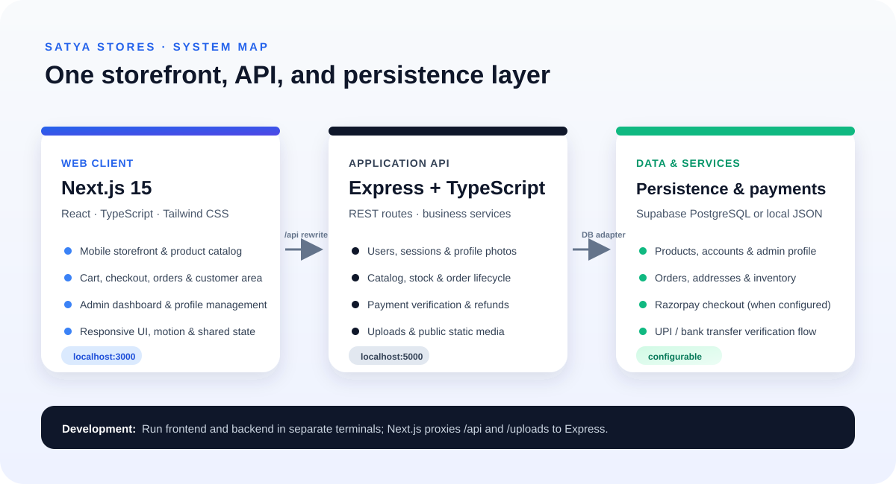
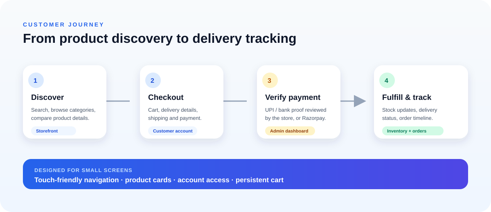

# Satya Stores

Satya Stores is a mobile-first e-commerce website for electronics and home appliances, built for Vasavi Enterprises. The project includes a customer storefront, account and order flows, and a store-owner administration dashboard.

## Project snapshot

| 16 app routes | 5 mobile nav destinations | 2 payment paths | 2 storage modes |
| --- | --- | --- | --- |
| Store, account, checkout, orders, admin, and more | Home, catalog, cart, wishlist, account | UPI/bank transfer and optional Razorpay | Local JSON or Supabase PostgreSQL |

These counts describe the code in this repository; they are not live store or sales metrics.

## System overview

## Shopping flow

## What the project includes

### Customer experience

- Browse and search products, explore categories, inspect product details, and select variants.
- Maintain a cart and wishlist.
- Create an account, manage contact details and delivery addresses, and add a profile photo.
- Place orders, submit UPI or bank-transfer evidence, and follow order status.
- View order history and individual order details.
- Use the responsive storefront and thumb-friendly mobile navigation.

### Store-owner dashboard

- Review orders and payment evidence; approve or reject payments.
- Manage delivery states, refunds, and payment settlements.
- Manage products, categories, inventory, promotions, and homepage content.
- Manage customer accounts, store settings, and the owner profile.
- Configure two-factor authentication.

### Payments

- **UPI or bank transfer:** customers submit payment details; the store owner verifies payment in the dashboard.
- **Razorpay:** optional checkout and webhook support when provider credentials are configured.

## Customer-facing routes

| Route | Page |
| --- | --- |
| / | Storefront home |
| /search | Product search |
| /category/[slug] | Category listing |
| /product/[slug] | Product details |
| /cart | Shopping cart |
| /checkout | Delivery and payment checkout |
| /favorites | Wishlist |
| /account | Customer profile and account overview |
| /orders | Order history |
| /orders/[id] | Order details and tracking |
| /auth/login | Customer sign-in |
| /auth/signup | Customer registration |
| /auth/forgot-password | Password reset |
| /pages/[slug] | Store information pages |
| /admin | Store-owner access and dashboard |

## Technology and architecture

| Area | Technology |
| --- | --- |
| Frontend | Next.js 15 App Router, React 19, TypeScript, Tailwind CSS |
| Backend | Node.js, Express, TypeScript |
| Cloud database | Supabase PostgreSQL |
| Local database | JSON file at backend/data/database.json |
| UI libraries | lucide-react, Framer Motion, Sonner |
| Payments | UPI/bank transfer flow and optional Razorpay integration |

The browser loads the Next.js app on port 3000. Next.js rewrites API and uploaded-media requests to the Express backend on port 5000. Backend services contain the business rules for accounts, catalog, orders, payments, inventory, delivery, and content.

## Repository structure

~~~text
.
├── README.md
├── docs/
│   └── images/                 # README architecture and flow illustrations
├── frontend/
│   ├── app/                    # Next.js pages and route segments
│   ├── components/
│   │   ├── admin/              # Admin dashboard upload tools
│   │   ├── layout/             # Header, footer, mobile navigation
│   │   ├── profile/            # Shared profile-photo picker
│   │   └── storefront/         # Hero, categories, product cards
│   ├── context/StoreContext.tsx
│   ├── lib/                    # Shared helpers and frontend seed data
│   └── next.config.mjs
└── backend/
    ├── db/                     # Local/Supabase database adapter and seed data
    ├── migrations/             # Incremental SQL migrations
    ├── services/               # Business logic
    ├── utils/                  # Password and admin-session utilities
    ├── schema.sql              # Supabase schema and seed statements
    ├── server.ts               # Express API and middleware
    └── types/
~~~

## Requirements

- Node.js 20 or newer and npm.
- Optional Supabase project for cloud persistence.
- Optional Razorpay account and credentials for Razorpay checkout.

## Install

Install dependencies for both applications:

~~~powershell
cd frontend
npm install

cd ..\backend
npm install
~~~

## Run in development

Start the backend and frontend in separate terminals from the repository root.

**Terminal 1 — backend**

~~~powershell
cd backend
npm run dev
~~~

The API listens on http://localhost:5000 by default. Its health endpoint is /api/health.

**Terminal 2 — frontend**

~~~powershell
cd frontend
npm run dev
~~~

Open http://localhost:3000. The frontend proxies /api and /uploads requests to the backend.

Development output is written to frontend/.next-dev; production builds use frontend/.next. Keeping these output folders separate prevents a build from replacing chunks served by the development server.

## Environment configuration

Create local environment files and keep them out of source control.

### frontend/.env.local

~~~dotenv
NEXT_PUBLIC_BACKEND_URL=http://127.0.0.1:5000
NEXT_PUBLIC_RAZORPAY_KEY_ID=
~~~

The backend URL defaults to port 5000 in local development. Set it when the API is hosted elsewhere. The Razorpay key ID is only needed for Razorpay checkout.

### backend/.env

~~~dotenv
PORT=5000
FRONTEND_URL=http://localhost:3000
SESSION_SECRET=replace-with-a-random-secret-of-at-least-32-characters
REDIS_URL=rediss://<managed-redis-endpoint>

# Local or Vercel Supabase backend credentials (never put the secret key in frontend/.env.local)
SUPABASE_URL=https://your-project.supabase.co
SUPABASE_SECRET_KEY=
# Existing projects can use SUPABASE_SERVICE_ROLE_KEY instead of SUPABASE_SECRET_KEY

# Production payment credentials; omit in development to use local-only mock behavior
RAZORPAY_KEY_ID=
RAZORPAY_KEY_SECRET=
RAZORPAY_WEBHOOK_SECRET=
~~~

Keep the admin-session secret, Redis URL, and Razorpay secret on the backend. Configure database credentials and Supabase row-level security for the intended deployment. See `docs/PRODUCTION_READINESS.md` for the production topology, cache policy, and scale gates.

## Deploy — Vercel (frontend) + Render (backend)

- **Frontend → Vercel**: the existing Next.js project (Root Directory = `frontend`). Set `NEXT_PUBLIC_BACKEND_URL` to the Render service URL (for example `https://satya-stores-backend.onrender.com`) and redeploy. Vercel's edge rewrites proxy `/api/*` and `/uploads/*` server-side, so the browser only ever talks to the Vercel origin and the `SameSite=Strict; Path=/` session cookies keep working. Public catalog responses now carry short edge-cache directives.
- **Backend → Render**: create a Render Web Service from this repo with **Root Directory = `backend`**, build command `npm ci && npm run build`, and start command `node dist/server.js`. Render injects `PORT`, which `server.ts` listens on automatically. Set the Health Check Path to `/ready`.
- Backend environment variables on Render: `FRONTEND_URL` (the exact deployed Vercel URL), `SESSION_SECRET` (at least 32 random characters), `SUPABASE_URL`, `SUPABASE_SECRET_KEY`, `REDIS_URL` (mandatory when running more than one API instance), `BLOB_READ_WRITE_TOKEN`, and the required Razorpay credentials. Keep secret keys out of frontend environment variables and source control.
- **Persistence**: without `SUPABASE_URL`/`SUPABASE_SECRET_KEY` the backend persists to `data/database.json`, which resets on every Render deploy because the disk is ephemeral — configure Supabase (below) or attach a persistent Render disk. Production image uploads require `BLOB_READ_WRITE_TOKEN` and Vercel Blob; the API rejects uploads rather than storing large inline data on ephemeral infrastructure. Images are limited to 3 MB.
- If Razorpay webhooks are configured, point the webhook URL at `https://<the-vercel-domain>/api/payments/razorpay/webhook` (the frontend proxies it to the backend).

## Database setup

### Local mode

Without Supabase credentials, the backend persists data to backend/data/database.json and creates the file when needed. Do not commit a database file that contains real customer or order data.

### Supabase mode

1. Set `SUPABASE_URL` and `SUPABASE_SECRET_KEY` in backend/.env. The secret key is backend-only and bypasses RLS; never expose it to the browser.
2. For a new project, run backend/schema.sql in the Supabase SQL editor.
3. For an existing project, apply `backend/migrations/20261108_lock_down_public_access.sql`, `backend/migrations/20261107_profile_images.sql`, and `backend/migrations/20261109_add_user_2fa_columns.sql` in the Supabase SQL editor.
4. Generate a new admin password hash with `cd backend` then `npm run hash-password`. In Supabase SQL Editor, create the owner account with the generated hash (or update the existing owner row): `INSERT INTO users (id, full_name, email, mobile_number, password, role, account_status) VALUES ('usr-admin-1', 'Store Owner', 'admin@sathyastores.com', '+910000000000', '<PASTE_HASH_HERE>', 'owner', 'active') ON CONFLICT (email) DO UPDATE SET password = EXCLUDED.password, role = 'owner', account_status = 'active';` Replace the sample phone with the owner's real number. Never use the old demo passwords.
5. Keep RLS enabled and do not add anon/authenticated access policies. The public client key is no longer used by the app. Rotate any credentials that were previously exposed or used in a deployed environment.

Vercel production runs fail closed if Supabase is missing or unavailable; it will not fall back to ephemeral JSON storage. Public catalog reads and store settings remain available for the storefront. Order data, user profiles, and all mutation routes require signed sessions and server-side validation.

## API overview

API routes are defined in backend/server.ts and use the /api prefix.

- **Authentication:** signup, login, forgot password, and reset password.
- **Customer accounts:** customer profile, favorites, and order history.
- **Catalog:** products, categories, promotions, and product reviews.
- **Orders:** creation, details, cancellation, payment evidence, and Razorpay order/verification.
- **Store operations:** admin profiles, users, orders, payments, refunds, inventory, delivery, coupons, layout, and settings.
- **Infrastructure:** health check, database status, and image upload.

Admin and customer API requests use expiring, signed HttpOnly cookies. Customer routes are scoped to the signed-in user; admin routes require the owner session. See backend/utils/session.ts, backend/server.ts, and the database-lockdown migration.

## Common commands

| Application | Command | Description |
| --- | --- | --- |
| Frontend | npm run dev | Run Next.js on port 3000 |
| Frontend | npm run lint | Run ESLint |
| Frontend | npm run build | Create and type-check the production build |
| Frontend | npm start | Serve the production build |
| Backend | npm run dev | Run Express with file watching |
| Backend | npm run build | Compile and type-check backend TypeScript |
| Backend | npm start | Start the backend server |

## Notes and troubleshooting

- If the frontend cannot reach the API, confirm the backend is running and NEXT_PUBLIC_BACKEND_URL points to it.
- If development chunks return 404 or the icon route fails, stop duplicate Next.js processes and restart npm run dev so Next.js can rebuild .next-dev.
- If profile photo writes fail in Supabase, apply the profile-image migration and inspect the backend error output.
- If Razorpay is unavailable, check the frontend public key and backend key ID/secret, then restart both apps.
- Product seed data contains remote image URLs, so product photography requires network access.
- Payment completion, email/SMS delivery, shipping integrations, and production security depend on provider and deployment configuration.

## Further reading

- Frontend notes: frontend/README.md
- Backend notes: backend/README.md
- Supabase schema: backend/schema.sql
- Incremental migrations: backend/migrations/
